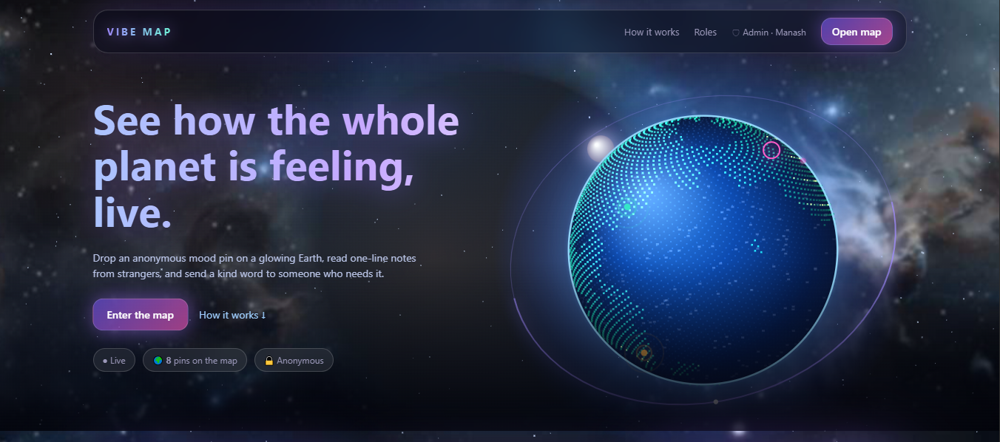
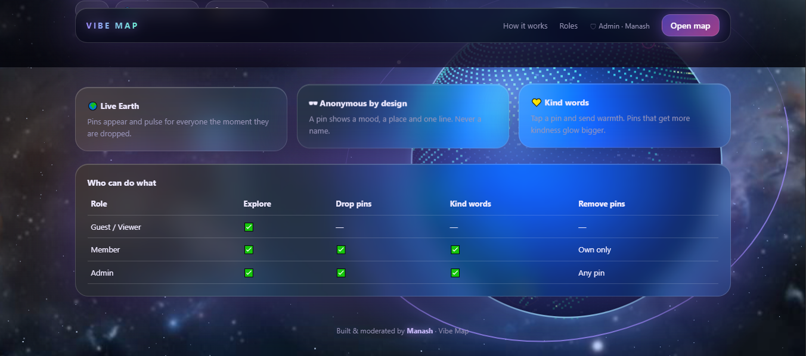
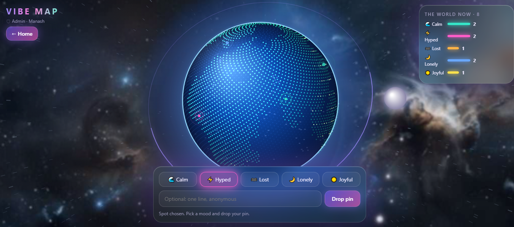

<div align="center">

# 🌍 Vibe Map

**See how the whole planet is feeling, live.**

Drop an anonymous mood pin on a glowing 3D Earth, read one-line notes from strangers, and send a kind word to someone who needs it.

  

</div>

---

## Screenshots


*Landing page with the live, rotating Earth, an orbiting moon and a satellite ring.*


*Feature cards and the role table (guest, member, admin).*


*The map: pick a mood, click the globe, drop a pin. The side panel shows the world's mood in real time.*

## Features

- 🌐 **Interactive 3D globe** drawn on a canvas, with real continent shapes, clouds, city lights, an atmosphere glow, a moon and a satellite ring. Drag to spin and tilt.
- 📍 **Mood pins** (Calm, Hyped, Lost, Lonely, Joyful) with an optional one-line note. Anonymous: pins never show a name.
- ⚡ **Real time**: new pins, kind words and removals appear for everyone instantly through Socket.io.
- 💛 **Kind words**: tap a pin and send warmth. Pins that receive more kindness glow bigger. One kind word per person per pin.
- 🔐 **Authentication and authorization**: JWT login with bcrypt-hashed passwords and role-based access (guest, member, admin).
- 🎬 **Motion**: nebula parallax that follows the cursor, a hyperspace jump when you enter the map, scroll-driven camera zoom, glowing glass UI.

## Project structure

```
vibe-map/
├── client/                 # Front end (Vite, vanilla JS, Canvas)
│   ├── index.html
│   ├── public/nebula.jpg
│   ├── src/main.js         # Globe, UI, auth modal, API and Socket.io client
│   ├── src/style.css
│   ├── vite.config.js      # Dev proxy to the server
│   └── .env.example
├── server/                 # Back end (Express, MongoDB, Socket.io)
│   ├── src/index.js        # App, security middleware, Socket.io
│   ├── src/models/         # User.js, Pin.js
│   ├── src/middleware/     # auth.js (authenticate + requireRole)
│   ├── src/routes/         # auth.js, pins.js
│   └── .env.example
├── docs/screenshots/
├── LICENSE
└── README.md
```

## Getting started

**Requirements:** Node.js 18+ and a MongoDB database (local, or a free MongoDB Atlas cluster).

### 1. Server

```bash
cd server
npm install
cp .env.example .env      # then edit the values
npm run dev               # http://localhost:5000
```

| Variable | Description |
|---|---|
| `PORT` | Server port (default `5000`) |
| `MONGO_URI` | MongoDB connection string |
| `JWT_SECRET` | Random string, 32+ characters |
| `ADMIN_EMAIL` | The account that registers with this email becomes the **admin** |
| `CLIENT_ORIGIN` | Allowed front-end origin(s), comma separated |

### 2. Client

```bash
cd client
npm install
npm run dev               # http://localhost:5173
```

In development Vite proxies `/api` and `/socket.io` to the server, so no extra config is needed. For production, copy `.env.example` to `.env` and set `VITE_API_URL` to your deployed API.

### 3. Become the admin

Set `ADMIN_EMAIL` in `server/.env` to Manash's email, start the server, then **sign up with that email** in the app. That account gets the admin role.

## Authentication and authorization

- Passwords are hashed with **bcrypt** (12 rounds). Sessions use a **JWT** valid for 7 days, sent as `Authorization: Bearer <token>`.
- The **role is never accepted from the client**. It is set by the server at registration and re-read from the database on every request.
- Login and register are rate limited, and the whole API is rate limited too.

| Role | Explore map | Drop pins | Send kind words | Remove pins |
|---|:-:|:-:|:-:|:-:|
| Guest (not logged in) | ✅ | ❌ | ❌ | ❌ |
| Member | ✅ | ✅ | ✅ | Own only |
| Admin | ✅ | ✅ | ✅ | Any pin |

## API

| Method | Endpoint | Access | Description |
|---|---|---|---|
| POST | `/api/auth/register` | Public | Create an account |
| POST | `/api/auth/login` | Public | Log in, returns a JWT |
| GET | `/api/auth/me` | Logged in | Current user |
| GET | `/api/pins` | Public | Latest 500 pins |
| POST | `/api/pins` | Member, Admin | Drop a pin (one every 5 s) |
| POST | `/api/pins/:id/kind` | Member, Admin | Send a kind word |
| DELETE | `/api/pins/:id` | Owner or Admin | Remove a pin |
| GET | `/api/health` | Public | Health check |

**Socket.io events (server to client):** `pin:new`, `pin:kind`, `pin:del`.

## Deployment

- **Database:** MongoDB Atlas (free tier).
- **Server:** Render or Railway. Root directory `server`, build `npm install`, start `npm start`. Add the environment variables above and set `CLIENT_ORIGIN` to your front-end URL.
- **Client:** Vercel or Netlify. Root directory `client`, build `npm run build`, output `dist`. Set `VITE_API_URL` to the server URL.

## Tech stack

Vite · Vanilla JS and Canvas 2D · Express · MongoDB with Mongoose · Socket.io · JWT · bcryptjs · Helmet · express-rate-limit

## License

Released under the [MIT License](LICENSE). Copyright (c) 2026 Manash.
